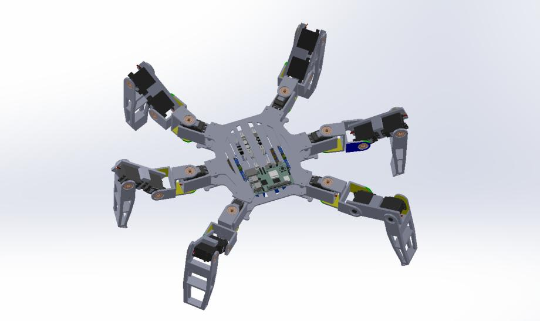
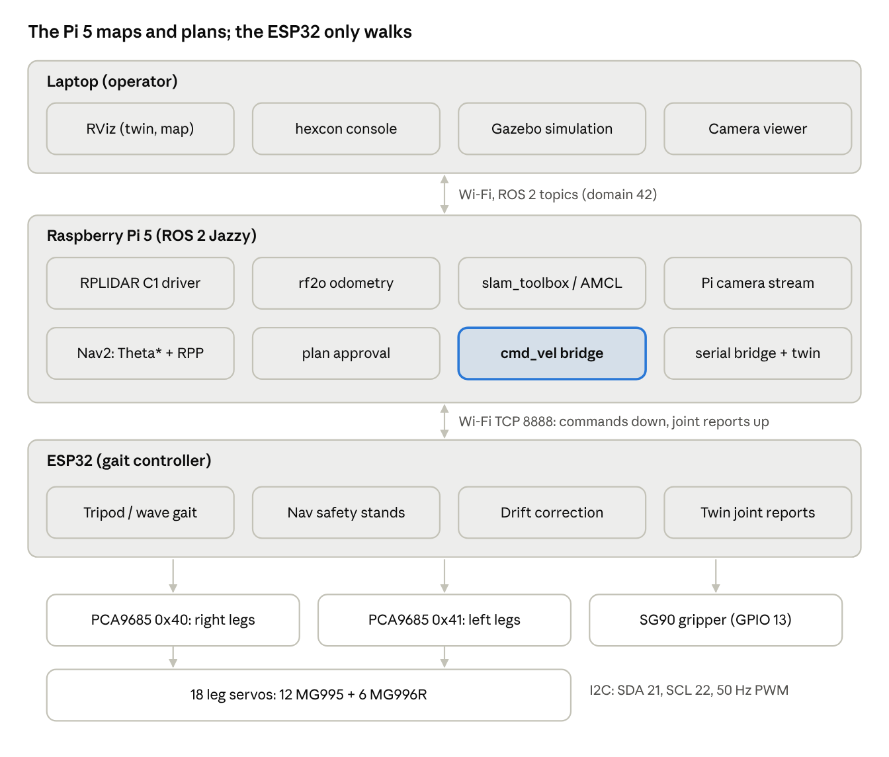
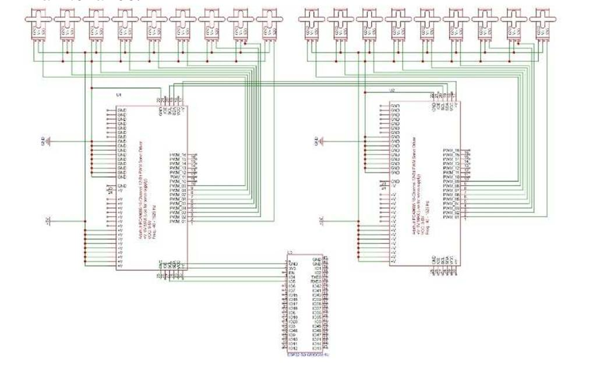
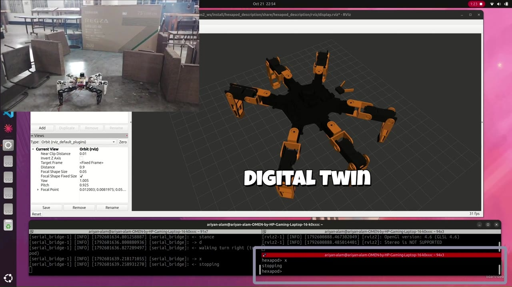
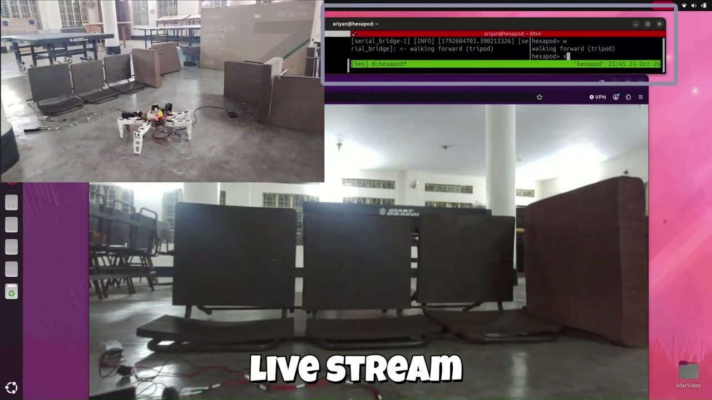
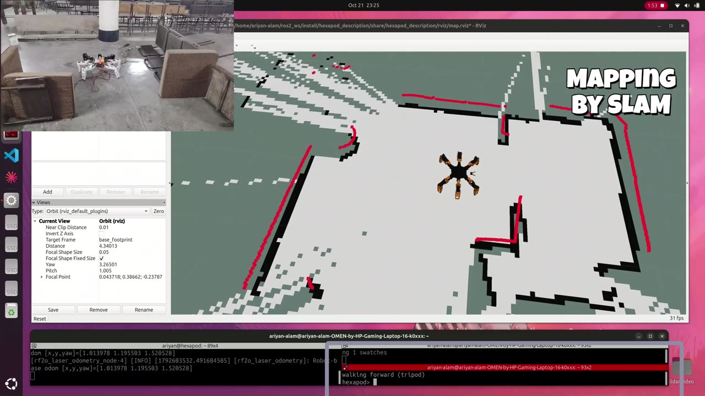
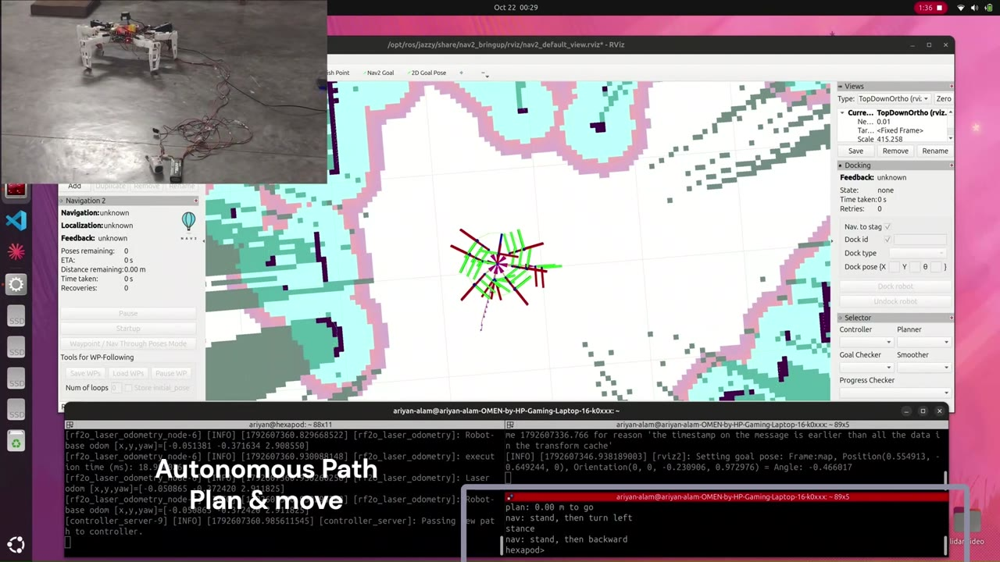
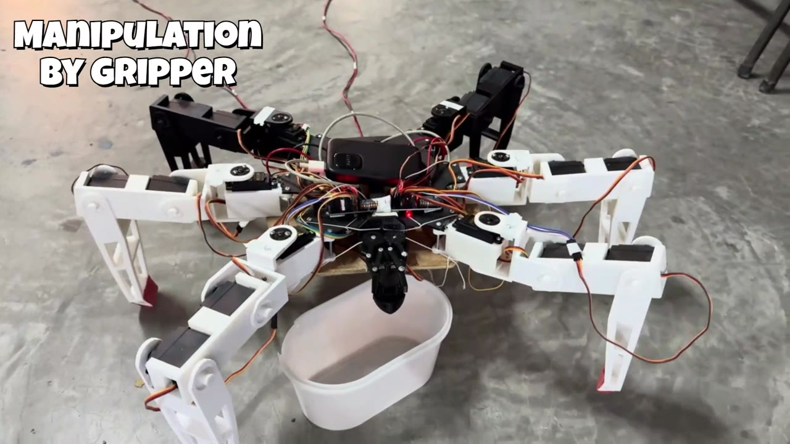
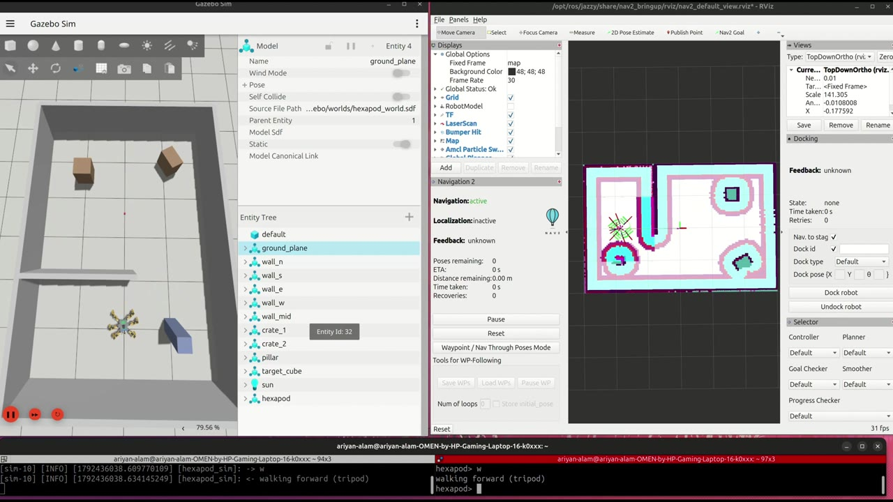

# 3D-Printed Hexapod for Semi-autonomous Navigation and Manipulation

**Khulna University of Engineering & Technology (KUET)** · Department of Mechatronics Engineering
**Course No:** MTE 3200 · **Project Progress Report**

| | |
|---|---|
| **Presented by** | Ariyan Alam, Roll 2231021, Department of Mechatronics Engineering, KUET |
| **Supervised by** | Anisha Anjum Meem, Lecturer, Department of Mechatronics Engineering, KUET |

---

## Contents

- [Demo Video](#demo-video)
- [Abstract](#abstract)
- [1. Introduction](#1-introduction)
- [2. Objectives](#2-objectives)
- [3. Project Progress](#3-project-progress)
  - [3.1 Design in SolidWorks](#31-design-in-solidworks)
  - [3.2 System Overview](#32-system-overview)
  - [3.3 Walking and Teleoperation](#33-walking-and-teleoperation)
  - [3.4 Digital Twin](#34-digital-twin)
  - [3.5 Live Camera Stream](#35-live-camera-stream)
  - [3.6 Mapping by SLAM](#36-mapping-by-slam)
  - [3.7 Autonomous Navigation](#37-autonomous-navigation)
  - [3.8 Manipulation by Gripper](#38-manipulation-by-gripper)
  - [3.9 Simulation](#39-simulation)
- [4. Remaining Work](#4-remaining-work)
- [5. Conclusion](#5-conclusion)
- [Appendix: Technical Reference](#appendix-technical-reference)

---

## Demo Video

[▶ Watch the demo video (2 min 48 s)](video/demo_video.mp4): walking, digital twin, live camera, SLAM mapping, autonomous navigation and the gripper.

---

## Abstract

This project develops a 3D-printed, 18-degree-of-freedom (DOF) hexapod for semi-autonomous navigation and manipulation. The architecture separates low-level actuation from high-level intelligence: an ESP32 with two PCA9685 PWM drivers runs the walking gaits on eighteen servos (12 MG995 and 6 MG996R), while a Raspberry Pi 5 runs ROS 2 for mapping, navigation and supervision, sending commands to the ESP32 over Wi-Fi. The robot walks in two selectable modes, the tripod gait for speed and the wave gait for stability. It builds 2D maps with an RPLIDAR C1, rf2o laser odometry and slam_toolbox, and navigates to goals with a lightweight Nav2 configuration. A gait-aware navigation interface translates Nav2 velocity commands into discrete gait commands with servo-protecting stands, turn-in-place and backward walking, and shows the planned path as gait steps for operator approval before the robot moves. A CAD-derived URDF model serves as a live digital twin in RViz and as a Gazebo simulation model. A Raspberry Pi camera provides a live video feed, and an SG90 gripper enables teleoperated grasping. The project aims to show that a low-cost, fully 3D-printed legged platform can combine stable multi-gait walking, LiDAR mapping, autonomous navigation and basic manipulation in one integrated system.

**Keywords:** Hexapod Robot, ROS 2, SLAM, Nav2, Digital Twin, Gazebo, Tripod Gait, Wave Gait, Teleoperation, 3D Printing

---

## 1. Introduction

Legged robots can walk where wheeled robots struggle, such as over uneven floors, steps and cluttered ground, because they place their feet at separate points instead of needing a continuous surface. A hexapod keeps at least three feet on the ground at all times, so it stays stable without active balancing. This makes it a good platform for learning and testing robotics, and it can be built with low-cost hobby servos.

Building such a robot as a student project is now practical. The body can be designed in CAD and 3D printed in PLA+ in-house, and open-source software (ROS 2, slam_toolbox and Nav2) together with a Raspberry Pi and a low-cost 2D LiDAR makes mapping and autonomous navigation possible without expensive hardware. Most low-cost hexapods, however, show only one part of this, either walking with a camera or LiDAR navigation, but rarely both together with a gripper on one robot.

This project builds a fully 3D-printed 18-DOF hexapod that combines these parts: it walks in two gaits, is teleoperated with a live camera feed, maps its surroundings with a LiDAR, navigates autonomously to goals and grasps objects with a gripper. The aim is a working, low-cost platform that brings walking, mapping, navigation and manipulation together in one system.

---

## 2. Objectives

The objectives of this project are as follows:

1. To design and fabricate a lightweight, modular, fully 3D-printed 18-DOF hexapod, each leg with coxa, femur and tibia segments driven by three servo motors.
2. To implement stable walking in two selectable modes, the tripod gait (speed) and the wave gait (stability), switchable by the operator and usable by the navigation system.
3. To develop a teleoperation interface over Wi-Fi with a keyboard console and a live first-person camera feed.
4. To pick and place small objects with a servo-actuated gripper under teleoperation.
5. To achieve 2D mapping and autonomous navigation with the RPLIDAR C1, ROS 2, slam_toolbox and Nav2, with servo-safe motion and operator approval of each planned path.
6. To build a digital twin (CAD-derived 3D model in RViz) and a Gazebo simulation of the robot for safe testing before running on hardware.

---

## 3. Project Progress

The robot is built and walking, and teleoperation, the digital twin, live video, SLAM mapping, autonomous navigation and grasping have all been demonstrated in the demo video.

### 3.1 Design in SolidWorks

The complete robot was designed in SolidWorks: the hexagonal body, the coxa, femur and tibia segments of each leg, the servo mounts and the electronics layout. All parts were then 3D printed in PLA+ and assembled. The same CAD assembly was later exported part by part to build the robot's 3D model for the digital twin and the simulation.

<p align="center">
  <br>
  <em>Figure 1: SolidWorks design of the 3D-printed 18-DOF hexapod</em>
</p>

### 3.2 System Overview

The ESP32 runs the walking gaits on 18 servos (12 MG995 + 6 MG996R) through two PCA9685 drivers; the Raspberry Pi 5 runs ROS 2 for mapping and navigation and sends commands to the ESP32 over Wi-Fi; the laptop is the operator station.

<p align="center">
  <br>
  <em>Figure 2: System architecture</em>
</p>

The ESP32 drives the two PCA9685 boards over I2C (SDA 21, SCL 22); each board controls the nine servos of one side of the robot, powered from the 5–6 V buck converters.

<p align="center">
  <br>
  <em>Figure 3: Circuit diagram of the servo control system (ESP32, two PCA9685 drivers and 18 servos)</em>
</p>

### 3.3 Walking and Teleoperation

The robot walks in two modes, the tripod gait (fast) and the wave gait (stable, five feet always down), forward, backward and turning in place. The operator switches gaits and drives the robot from a keyboard console over Wi-Fi.

### 3.4 Digital Twin

A 3D model generated from the SolidWorks design moves in RViz exactly as the real robot moves, driven by the joint angles the ESP32 reports.

<p align="center">
  <br>
  <em>Figure 4: Real robot (top left) and its digital twin in RViz</em>
</p>

### 3.5 Live Camera Stream

A Raspberry Pi camera streams first-person video to the laptop for teleoperation.

<p align="center">
  <br>
  <em>Figure 5: Live first-person video while driving</em>
</p>

### 3.6 Mapping by SLAM

The RPLIDAR C1 with laser odometry (rf2o) and slam_toolbox builds a 2D map while the robot walks; the robot model is shown on the map.

<p align="center">
  <br>
  <em>Figure 6: Map built by the walking robot</em>
</p>

### 3.7 Autonomous Navigation

Nav2 plans a path to a goal clicked on the map. The plan is shown as simple steps (turn, walk N cycles) and the robot starts only after the operator types `go`. A custom bridge turns Nav2's speed commands into gait commands, with a stand before every change of direction to protect the servos, turning in place and walking backward when the goal is behind.

<p align="center">
  <br>
  <em>Figure 7: Autonomous path planning and movement to the goal</em>
</p>

### 3.8 Manipulation by Gripper

The SG90 gripper grasps and carries a small container under teleoperation.

<p align="center">
  <br>
  <em>Figure 8: The gripper holding a container</em>
</p>

### 3.9 Simulation

The same robot model and gait run in a Gazebo simulation, where walking, mapping and navigation are tested before running on the real robot. The simulated hexapod is driven from the same console, and the SLAM map of the simulated room is built in RViz as it walks with the tripod gait.

<p align="center">
  <br>
  <em>Figure 9: Gazebo simulation (left) and the map of the simulated room built in RViz (right)</em>
</p>

---

## 4. Remaining Work

1. **Navigation tuning:** make the robot reach goals more accurately and reliably, with fewer direction changes.
2. **Obstacle avoidance:** make the robot go around both static obstacles (walls, furniture) and dynamic obstacles (people, objects placed in its path) during navigation.
3. **Testing and performance evaluation:** run repeated trials to measure how well the system performs, including navigation success rate, how close the robot stops to the goal, time taken, map accuracy compared with real room measurements, and the speed and drift of the tripod and wave gaits.

---

## 5. Conclusion

Five of the six objectives have been achieved, and the sixth works but still needs tuning. The hexapod was designed in SolidWorks, 3D printed in PLA+ and assembled with 18 servos, and it walks reliably in both the tripod and the wave gait, forward, backward and turning, with the operator able to switch between them. It is driven over Wi-Fi from a keyboard console while the Pi camera streams live video to the laptop, and its gripper grasps and carries a small container under teleoperation. The CAD-based 3D model moves together with the real robot in RViz as a digital twin, and the same walking, mapping and navigation run in a Gazebo simulation. The robot also builds 2D maps of its surroundings with the LiDAR and reaches goals autonomously with Nav2 after the operator approves the planned path, so mapping and navigation are largely in place. What remains is to tune the navigation for better accuracy and to add avoidance of static and dynamic obstacles, which will complete the last objective.

---

## Appendix: Technical Reference

### Hardware

| Component | Model | Qty | Purpose |
|---|---|---|---|
| Leg servos | MG995 | 12 | Leg joints |
| Leg servos | MG996R | 6 | Leg joints |
| Gripper servo | SG90 | 1 | Gripper open/close (GPIO 13), mounted at the back of the base |
| Servo driver | PCA9685 (I2C, 16-ch) | 2 | Drives the 18 leg servos (addresses 0x40 and 0x41, 50 Hz) |
| Microcontroller | ESP32 (current) / STM32 (planned) | 1 | Low-level servo and gait control |
| Main computer | Raspberry Pi 5 | 1 | ROS 2 Jazzy, SLAM, navigation, high-level commands |
| LiDAR | RPLIDAR C1 | 1 | Mapping and obstacle detection, mounted on top |
| Camera | Raspberry Pi Camera v2 | 1 | Live first-person video (the camera side is the front) |
| IMU | MPU6050 | 1 | Orientation (planned for odometry) |
| Power | XL4005 buck converters | — | 5–6 V servo supply |

### Leg layout

```
          front (camera)
      0 ───────── 3
      │           │
      1           4
      │           │
      2 ───────── 5
          back (gripper)
```

- Legs 0–2 (right side) on PCA9685 **0x40**, legs 3–5 (left side) on **0x41**
- Tripod A = legs 0, 4, 2 · Tripod B = legs 3, 1, 5

### Firmware commands (ESP32)

The firmware accepts text commands over USB serial (115200) or Wi-Fi (TCP port 8888). Set your own Wi-Fi name and password in the sketch before flashing.

| Command | Action |
|---|---|
| `w` / `s` | Walk forward / backward |
| `a` / `d` | Turn left / right in place |
| `x` | Stop and settle into stance |
| `tripod` / `wave` | Choose the gait |
| `g` / `r` / `grip` | Grab / release / toggle the gripper |
| `1`, `1 d` | One gait cycle (forward, or turning right, etc.) |
| `h` / `c` / `p` | Stance / center all joints / print pose |
| `t` | Test each leg in turn |
| `swing` / `turn` / `lift` / `tuck` / `stance` / `speed` `<value>` | Gait tuning |
| `twin on` / `twin off` | Joint reports for the RViz digital twin |
| `navgait wave` / `navgait tripod` | Gait used by Nav2 (saved) |
| `navsteps` / `navtsteps <n>` | Rest stand every n cycles during navigation, wave / tripod |
| `fdrift` / `bdrift <value>` | Straight-line correction forward / backward (−10..10, saved) |
| `?` | Show all commands |

### Software

- Arduino IDE (ESP32 firmware): `Adafruit_PWMServoDriver`, `ESP32Servo`
- ROS 2 Jazzy on Raspberry Pi 5: `rplidar_ros`, `rf2o_laser_odometry`, `slam_toolbox`, Nav2
- Gazebo Harmonic on the laptop for simulation
- SolidWorks for the mechanical design

### Repository contents

The CAD files of the robot are in this repository:

- `Hexapod_full_assembly.SLDASM`: the full SolidWorks assembly
- Printed parts: `ghost_spider_base`, `spider_base_cut`, `roof`, `box`, `bracket`, `holder`, `horn`, `legpiece`, `long_leg`, `d`, `trial` (`.SLDPRT`)
- Electronics models: `Perfect_MG996r.SLDPRT`, `PCA9685 16.SLDPRT`, `RPLIDAR C1.SLDPRT`, `Raspberry-Pi-5.step`, `Shield ESP32.step`, `ESP-EYE v2.step`, `300W 20A DC-DC Buck Converter Step Down.step`
- `images/`: figures used in this README
